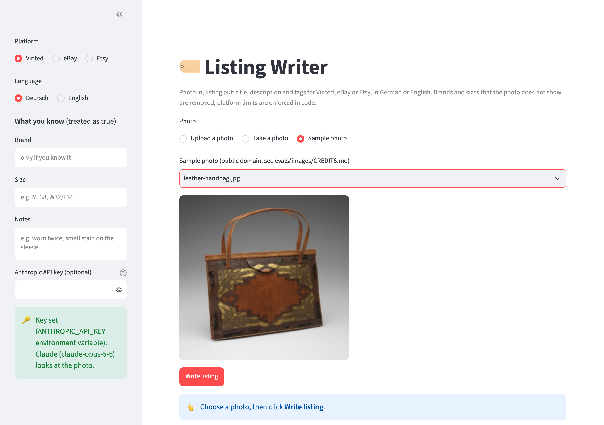
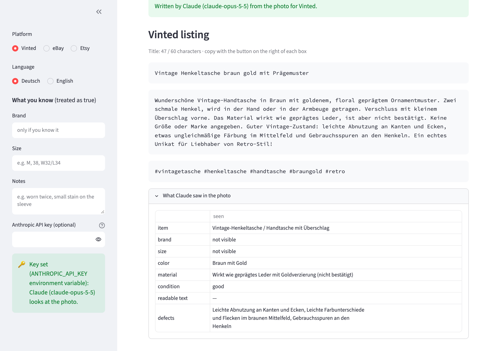
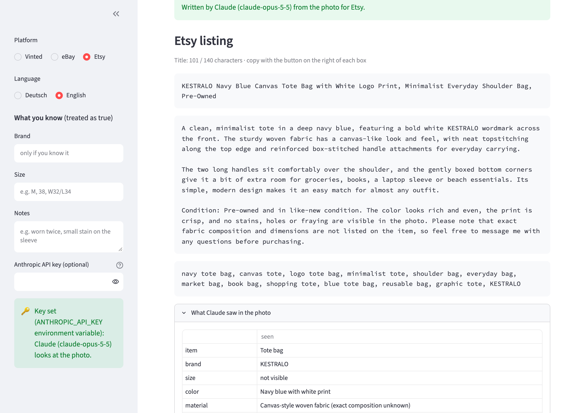

# listing-writer

Photo in, listing out. Upload a photo of something you want to sell and Claude writes the title,
description and tags for **Vinted, eBay or Etsy**, in **German or English**. Claude first describes what
it sees (item, brand, size, color, condition and every word it can read), then writes the listing from
that. A guardrail removes any brand or size that is not readable in the photo and was not given by the
seller, and each platform's limits are enforced in code. A labeled eval measures how often brands are
invented.

## Preview

Pick a platform and language, add what you know (brand, size, notes), then upload a photo, take one
with your webcam or use a sample:



The leather handbag is the trap: its source file is called "Prada handbag", but no logo is visible, so
the German Vinted listing names no brand. Claude even marks the material as "not confirmed". Each box has
a copy button for pasting into the marketplace, and "What Claude saw" shows what the listing is based on:



The tote bag shows the opposite case: "KESTRALO" is an invented brand, but it is printed on the bag, so
the Etsy listing uses it. Exactly 13 tags, each at most 20 characters:



## Run it locally (step by step)

You need **Python 3.10+** and **git**. Everything runs on your own machine.

1. Get the code:
   ```bash
   git clone https://github.com/ExNNeph/listing-writer.git
   cd listing-writer
   ```
2. Create and activate a virtual environment, so nothing is installed system-wide:
   ```bash
   python3 -m venv .venv
   source .venv/bin/activate          # Windows: .venv\Scripts\activate
   ```
3. Install the project with the demo extras:
   ```bash
   pip install -e ".[demo]"
   ```
4. Start the demo:
   ```bash
   listing-writer demo
   ```
   Your browser opens **http://localhost:8501**. If it does not, open that address yourself.
5. Stop it with `Ctrl-C` in the terminal. Next time, only steps 2 (`source .venv/bin/activate`) and 4 are needed.

Things to try in the demo:
- Pick **Sample photo** and try the **leather handbag**: its original file name says Prada, but no logo
  is visible, so the listing must not mention a brand.
- Try the **tote bag**: its brand "KESTRALO" is invented, but it is printed on the bag, so it is used.
- Switch the platform: eBay titles stop at 80 characters and get no tags, Etsy gets up to 13 tags,
  Vinted gets hashtags.
- Type a size under **What you know**: sizes you give are kept, sizes Claude only guesses are removed.
- **Upload** your own photo or use **Take a photo** with your webcam. Without an API key you get a
  fill-in template from your own facts; paste a key in the sidebar and press Enter to let Claude look.

## How it works

1. `prepare_image()`: the photo is rotated according to its EXIF data, scaled to at most 1568 px (the size
   Claude uses; larger only costs tokens) and re-encoded as JPEG, which also removes metadata such as the
   GPS position before anything is sent.
2. `write()`: Claude (`claude-opus-5-5`) gets the photo, the platform's rules and style, the language and
   the seller's own facts, and returns **structured output** (`output_config.format` with a JSON schema):
   attributes first (item, brand, size, color, material, condition, readable text, defects), then title,
   description and tags.
3. **Guardrail** (`guard()`): a brand or size is kept only if it appears in the text Claude reports as
   readable in the photo, or if the seller gave it. Otherwise it is removed from the title, description and
   tags, including spelling variants ("Levi's" also removes the tag "levis"), and the change is reported.
4. **Platform rules** (`enforce()`, `platforms.py`): title cut at a word boundary to the platform limit,
   tags cleaned (no `#`, no duplicates, max length and count), no tags where the platform has none.
5. Without an API key, or if the call fails, a **fill-in template** is built from the seller's facts.

| platform | title | tags |
|---|---|---|
| Vinted | 60 characters (our choice for readable titles, not a Vinted limit) | up to 5, shown as hashtags |
| eBay | 80 characters | none (eBay uses item specifics) |
| Etsy | 140 characters | up to 13, each up to 20 characters |

## Command line

```bash
listing-writer photo.jpg --platform etsy --lang en --brand "Acme" --size M --notes "worn twice"
```

| Variable | Needed for |
|---|---|
| `ANTHROPIC_API_KEY` | Claude looking at the photo (optional; without it you get the fill-in template) |
| `LISTING_WRITER_MODEL` | override the model (default `claude-opus-5-5`) |

The request opts into the API's server-side refusal fallback (`fallbacks: "default"`).

## Evals

`evals/images/` holds 12 photos with hand labels in `evals/gold.json`: 8 public-domain photos from
Wikimedia Commons and 4 generated ones (sources in `evals/images/CREDITS.md`). Four show a readable brand
(adidas, AVIA, FESTINA and the invented KESTRALO), eight show none. Two are deliberate traps:

- **leather handbag**: the Commons file name says "Prada", but no logo is visible. Claude only gets the
  image, so naming Prada would be an invented brand.
- **tote bag**: "KESTRALO" is a made-up brand, printed large on the bag. A model that only trusts brands
  it knows would wrongly drop it.

Every photo runs on all three platforms (Vinted in German, eBay in English, Etsy in German), 36 listings
in total. Measured: the item is recognized, the color is right, the brand is right (found when visible,
absent when not), **brands invented before and after the guardrail**, labeled visible facts used (the
book's title, the heart shape), the language, and how often the platform rules had to step in.

```bash
python evals/run_eval.py          # needs ANTHROPIC_API_KEY; prints every error per photo
pytest                            # unit tests + sanity checks on the eval set, no API calls
```

## Results

| photos | listings | item | color | brand right | brand invented (before → after guardrail) | visible facts used | language | rule fixes |
|---|---|---|---|---|---|---|---|---|
| 12 | 36 | 100% | 100% | 100% | **0 → 0** | 5 / 6 | 100% | 1 |

Claude read adidas, AVIA and FESTINA (the last from a slightly blurred macro shot) and the invented
KESTRALO in every run, and never named a brand for the eight photos without one, including the Prada
handbag. The guardrail therefore never had to remove a brand in this run; it is the safety net for the
cases this set does not contain. The one missed fact was a labeling bug, not a model error: the German
Vinted listing for the sunglasses said "Herz" while the label only accepted "heart". The label now accepts
both. The platform rules corrected one listing.

Cost: about 2,250 input and 780 output tokens per listing (the image is most of the input), roughly
$0.025 per listing at Opus 5.5 prices; the full run (36 listings) cost about $0.88.

**What this does not show:** 12 photos is a small set, most of them clear and well lit. The guardrail can
only check consistency with what Claude itself reports as readable, so a model that also invented the
label text would get past it; the eval against hand labels is the real check. Next steps: blurry and
cluttered photos, several items in one photo, and a second "is this brand really visible?" check.

## Known limits

- One photo per listing; no measurements, no price suggestion.
- Brand and size are only as reliable as the text Claude reads; small or angled labels can be missed.
- HEIC photos (iPhone default) are not supported; export as JPG first.

## License

MIT. Photos in `evals/images/`: see `CREDITS.md`.
